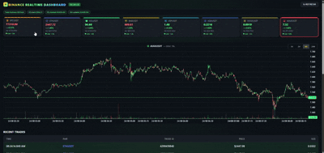
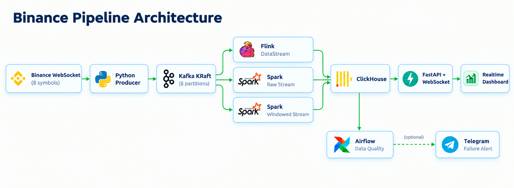

# Binance Realtime Pipeline.

Local realtime data-engineering pipeline that ingests Binance trade events,
streams them through Kafka, processes them with either Flink or Spark, stores
raw and aggregated data in ClickHouse, runs scheduled data-quality checks with
Airflow, and serves a realtime dashboard through FastAPI and WebSocket.

## Demo.

<p align="center">
  
</p>

## Architecture.



Flink and Spark are alternative processing engines. Only one engine should run
at a time.

Tracked symbols: `BTCUSDT`, `ETHUSDT`, `SOLUSDT`, `BNBUSDT`, `XRPUSDT`,
`ADAUSDT`, `DOGEUSDT`, and `AVAXUSDT`.

## Data flow.

1. The Python producer connects to the Binance combined WebSocket and
   normalizes each trade to this contract:

   ```text
   symbol, trade_id, price, quantity, trade_time, is_buyer_maker
   ```

2. The producer publishes to `binance-trades` using `symbol` as the Kafka key.
   Events for one symbol therefore retain order within their assigned
   partition.
3. Flink or Spark reads Kafka and writes both raw trades and 10-second OHLC
   aggregates to ClickHouse.
4. ClickHouse materialized views build engine-aware and engine-neutral serving
   layers. Dashboard and data-quality queries use the global canonical layer,
   so replaying the same Binance trade through another engine does not double
   count it.
5. FastAPI queries optimized read models and broadcasts six WebSocket feeds:
   latest price, recent trades, live candle, finalized OHLC, 24-hour statistics,
   and data-quality status.
6. Airflow runs gap, price-anomaly, and freshness checks every 15 minutes.

## Processing engines.

### Flink.

Flink uses event-time processing with a 10-second tumbling window.

The raw path provides sub-window realtime updates. Finalized OHLC latency also
includes window closure, watermark progression, and sink behavior. Therefore, it is not a millisecond-level OHLC processing procedure.

### Spark.

Spark runs two Structured Streaming queries:

- `spark-microbatch`: raw trades, default trigger every 5 seconds.
- `spark-windowed`: 10-second OHLC aggregation, default trigger every 10 seconds.

## Dashboard. 

The dashboard is engine-neutral and reads the canonical serving layer, so its
views remain unchanged when the active processing engine changes.

Available views:

- Realtime ticker cards for all eight symbols.
- Price, 24-hour percentage change, quote volume, and freshness state.
- Timeframe selector for `1H`, `3H`, `6H`, and `24H` chart views.
- Ten-second candles with a live current candle for `1H`/`3H`/`6H`; the `24H`
  view aggregates canonical ten-second OHLC into one-minute candles.
- Smooth symbol switching through cached data.
- Recent trades with millisecond timestamps and Binance `trade_id`.
- 24-hour low, high, average, trade count, and quote-volume comparison.
- Data-quality status and recent alert summary.

Sparse candles are valid when a symbol has no trade in a window. The dashboard
does not fabricate unlabeled synthetic candles. The 24-hour statistics only
cover data present in ClickHouse, so they look small right after a fresh start.

## Airflow data quality.

The `binance_data_quality` DAG runs three independent checks every 15 minutes:

| Task | Check |
|---|---|
| `gap_detection` | Unexpected gaps in Binance trade IDs after a five-minute settling period. |
| `price_anomaly` | Abnormal price movement between consecutive OHLC windows. |
| `consumer_lag_check` | Missing or stale symbols based on ClickHouse event-time freshness. |

Findings are stored in `binance.alerts` first. Telegram notification is
optional: when configured, the DAG sends a short summary of findings after each
task (best effort, it never fails the task) and a message when a task fails.
It stays disabled while its environment variables are blank. A finding can be
repeated on every 15-minute run while the condition persists.

## Prerequisites.

- Docker Desktop with Docker Compose. On Docker Desktop (WSL2), allocate at least 8 GB of memory.
- Python 3.14 and uv for manual commands.
- Free host ports `8000`, `8080`, `8123`, `9000`, and `9092`.
- Do not run Spark and Flink concurrently.
- Internet access to pull images and receive Binance public WebSocket events.

## Quick start.

Complete command list for a fresh clone on Windows PowerShell, run from the repository root.

### 1. Configure .env before the first start.

```powershell
$env:PYTHONUTF8='1'
uv sync --frozen --dev --all-extras
uv run --frozen python -m compileall -q src
docker compose --env-file .env.example --profile '*' config --quiet
Copy-Item .env.example .env
```

Open .env and then edit .env: replace every change-me value.

### 2. Start the pipeline with Flink.

```powershell
$env:PIPELINE_ACTIVE_ENGINE='flink'
docker compose --profile infra --profile flink --profile airflow --profile dashboard up -d --build
docker compose --profile '*' ps -a
```

Flink is the default engine. The first build downloads the pinned images and
dependencies, so it can take several minutes. Spark remains an alternative
engine documented under [Switching engines](#switching-engines).

The `infra` profile starts the health-checked producer automatically. Do not
run `src/producer/binance_producer.py` separately while the container is
active, or Binance trades will be published twice.


### 3. Open the services.

| Service | Local address | Login |
|---|---|---|
| Dashboard | http://localhost:8000 | none |
| Airflow | http://localhost:8080 | `AIRFLOW_ADMIN_USER` / `AIRFLOW_ADMIN_PASSWORD` from `.env` |

Trigger the data-quality DAG once to see it run:

```powershell
$runId='manual_'+(Get-Date -Format 'yyyyMMdd_HHmmss')
docker exec airflow-scheduler airflow dags trigger -r $runId binance_data_quality
Start-Sleep 15
docker exec airflow-scheduler airflow tasks states-for-dag-run binance_data_quality $runId
```

Expected: `gap_detection`, `price_anomaly` and `consumer_lag_check` are
`success`.

## Switching engines.

Stop the active engine before starting the other one. Shell variables
override `.env`, so set `PIPELINE_ACTIVE_ENGINE` every time.

Flink to Spark (new checkpoints start at the live edge):

```powershell
docker compose --profile '*' stop flink
$stamp=Get-Date -Format 'yyyyMMddHHmmss'
$env:PIPELINE_ACTIVE_ENGINE='spark'
$env:SPARK_MICROBATCH_CHECKPOINT_LOCATION="/tmp/checkpoints/live_raw_$stamp"
$env:SPARK_WINDOWED_CHECKPOINT_LOCATION="/tmp/checkpoints/live_window_$stamp"
docker compose --profile infra --profile spark-microbatch up -d --build --force-recreate spark-microbatch spark-windowed
docker compose --profile infra --profile dashboard up -d --no-deps --force-recreate dashboard
```

Spark to Flink:

```powershell
docker compose --profile '*' stop spark-microbatch spark-windowed
Remove-Item Env:SPARK_MICROBATCH_CHECKPOINT_LOCATION,Env:SPARK_WINDOWED_CHECKPOINT_LOCATION -ErrorAction SilentlyContinue
$env:PIPELINE_ACTIVE_ENGINE='flink'
docker compose --profile infra --profile flink up -d --no-deps --force-recreate flink
docker compose --profile infra --profile dashboard up -d --no-deps --force-recreate dashboard
```


## Project structure

```text
Binance_etl_pipeline/
├── .github/                          # CI and Dependabot
│   ├── workflows/ci.yml
│   └── dependabot.yml
├── clickhouse/
│   ├── init.sql                      # Full schema for a fresh clone
│   ├── configure_retention.sh        # Environment-driven TTL setup
│   └── migrations/                   # Additive upgrades 001-004
├── demo/                             # README assets
├── src/
│   ├── producer/                     # Binance WebSocket -> Kafka
│   │   ├── binance_producer.py
│   │   └── test_binance_producer.py
│   ├── consumer/                     # Flink and Spark engines
│   │   ├── ohlc_logic.py             # Framework-neutral OHLC logic (Flink)
│   │   ├── flink_ohlc_consumer.py
│   │   ├── spark_microbatch_consumer.py
│   │   ├── spark_windowed_aggregation.py
│   │   ├── clickhouse_http.py        # Retrying ClickHouse HTTP sink
│   │   ├── spark_entrypoint.sh       # Graceful Spark shutdown wrapper
│   │   └── Dockerfile.flink / .spark / .spark-windowed
│   ├── dashboard/                    # FastAPI, WebSocket, UI
│   │   ├── main.py
│   │   ├── clickhouse_client.py
│   │   ├── pipeline_health.py
│   │   └── static/index.html
│   ├── airflow/                      # Data-quality DAG
│   │   ├── dags/                     # DAG, check logic, ClickHouse client, Telegram
│   │   └── Dockerfile
│   └── maintenance/                  # Checkpoint and log cleanup
├── .env.example                      # Safe configuration template
├── docker-compose.yml                # Profile-based orchestration
├── pyproject.toml
└── uv.lock                           # Frozen Python dependencies
```


## Safe shutdown

Stop containers without deleting persistent data:

```powershell
docker compose --profile '*' down
```

Avoid `docker compose --profile '*' down -v` unless you want to permanently delete the data for Kafka, ClickHouse, checkpoints, and Airflow.